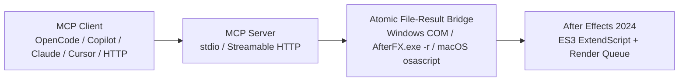

# After Effects MCP

TypeScript Model Context Protocol (MCP) server for Adobe After Effects 2024 (v24.x). It exposes project, composition, layer, typography, 3D, effect, render-queue, expression, font, track-matte, frame-capture, and raw ExtendScript operations to MCP clients.

Runtime requirements: Node.js 24, TypeScript 5.9.3, `@modelcontextprotocol/sdk` 1.30.0, Zod 3.25.76, and Adobe After Effects 2024 (v24.x).

See [CHANGELOG.md](CHANGELOG.md) for release history.

## Architecture



The server wraps each ExtendScript call in an undo group and writes a structured JSON result file to the operating-system temporary directory. Windows attempts AE COM first and can fall back to `AfterFX.exe -r`; macOS uses `osascript` and `DoScript`. If AE does not write a valid result before timeout, the tool returns `isError: true`.

## Prerequisites

- Windows or macOS
- Node.js 24
- Adobe After Effects 2024 (v24.x)

In After Effects, open **Edit → Preferences → Scripting & Expressions** and enable **Allow Scripts to Write Files and Access Network**. This preference is required for the JSON result-file bridge and `comp.saveFrameToPng()` frame captures.

`aerender` is not currently invoked by this repository. The `add_to_render_queue` tool adds the selected composition to AE's Render Queue; it does not start or monitor an external `aerender` process.

## Installation and Verification

```powershell
git clone https://github.com/Ranjith-paideia/AFTER-EFFECTS-MCP.git
cd AFTER-EFFECTS-MCP
npm install
npm run build
npm run typecheck
npm test
```

`node_modules/` and `dist/` are generated directories and are not tracked by Git.

## Client Configuration

### OpenCode

Create `opencode.json` in the project:

```json
{
  "$schema": "https://opencode.ai/config.json",
  "mcp": {
    "after-effects": {
      "type": "local",
      "command": ["node", "C:\\path\\to\\AFTER-EFFECTS-MCP\\dist\\index.js"],
      "enabled": true,
      "environment": {
        "AE_DISABLE_RAW_SCRIPT": "0"
      }
    }
  }
}
```

OpenCode uses `mcp`, `"type": "local"`, and an array-valued `command`.

### GitHub Copilot / VS Code

Add a stdio server to `.vscode/mcp.json`:

```json
{
  "servers": {
    "after-effects": {
      "type": "stdio",
      "command": "node",
      "args": ["C:\\path\\to\\AFTER-EFFECTS-MCP\\dist\\index.js"]
    }
  }
}
```

### Claude Desktop

Add to `claude_desktop_config.json`:

```json
{
  "mcpServers": {
    "after-effects": {
      "command": "node",
      "args": ["C:\\path\\to\\AFTER-EFFECTS-MCP\\dist\\index.js"]
    }
  }
}
```

### Cursor

Add to `.cursor/mcp.json`:

```json
{
  "mcpServers": {
    "after-effects": {
      "command": "node",
      "args": ["C:\\path\\to\\AFTER-EFFECTS-MCP\\dist\\index.js"]
    }
  }
}
```

### Streamable HTTP

The HTTP endpoint is disabled by default. Enable it with:

```powershell
$env:AE_MCP_HTTP_PORT="3100"
npm start
```

It binds only to `127.0.0.1`, at `http://127.0.0.1:3100/mcp`. The accepted port range is `1`–`65535`. This implementation does not add Bearer authentication or TLS.

An HTTP client must send `Accept: application/json, text/event-stream` and `Content-Type: application/json`.

## MCP Capabilities

### Tools

Annotations are MCP hints, not enforcement or authorization.

| Tool | Read-only | Destructive | Idempotent | Purpose |
|---|---|---|---|---|
| `create_composition` | No | Yes | No | Creates a new composition. |
| `generate_scene_slate` | No | Yes | No | Generates a production slate with scene, take, and director information. |
| `set_timeline_markers` | No | Yes | No | Sets composition timeline markers. |
| `create_adjustment_layer` | No | Yes | No | Creates an adjustment layer in the composition. |
| `animate_transform_with_curves` | No | No | No | Animates a transform property with keyframes and easing curves. |
| `separate_position_dimensions` | No | Yes | No | Separates the position dimensions of a layer. |
| `create_motion_path` | No | No | No | Creates a motion-path animation with optional auto-orientation. |
| `create_shape_with_trim_paths` | No | Yes | No | Creates a shape layer with trim paths. |
| `generate_shape_repeater` | No | Yes | No | Generates a shape repeater setup. |
| `apply_shape_modifiers` | No | No | No | Applies a vector modifier filter to a shape layer. |
| `create_kinetic_text` | No | Yes | No | Creates styled text for kinetic typography. |
| `apply_text_animator` | No | No | No | Applies a preconfigured text animator preset. |
| `build_auto_resizing_subtitle_box` | No | Yes | No | Builds text with a dynamic auto-resizing background box. |
| `build_master_null_rig` | No | Yes | No | Parents target layers to a newly created master null. |
| `create_camera_orbit_rig` | No | Yes | No | Creates a camera parented to a 3D orbit-control null. |
| `add_expression_controllers` | No | Yes | No | Adds expression-control effects to a layer. |
| `apply_effect_stack` | No | No | No | Applies an effect stack with optional parameters. |
| `create_displacement_glitch` | No | Yes | No | Creates a procedural displacement-map glitch effect. |
| `create_gradient_light_leak` | No | Yes | No | Generates a gradient-ramp light-leak layer. |
| `convert_audio_to_keyframes` | No | Yes | No | Runs Convert Audio to Keyframes on an audio layer. |
| `link_property_to_audio` | No | No | No | Links a property to audio-keyframe expressions. |
| `add_to_render_queue` | No | Yes | No | Adds a composition to the Render Queue. |
| `execute_extendscript` | No | Yes | No | Executes raw ExtendScript supplied by the client. |
| `execute_raw_extendscript` | No | Yes | No | Compatibility alias for `execute_extendscript`. |
| `get_project_info` | Yes | No | Yes | Gets basic active-project information. |
| `get_composition_info` | Yes | No | Yes | Gets detailed composition and layer information. |
| `list_fonts` | Yes | No | Yes | Lists filtered `app.fonts.allFonts` entries. |
| `set_composition_renderer` | No | Yes | Yes | Sets a verified AE 2024 composition renderer. |
| `set_track_matte` | No | No | Yes | Sets or removes a track matte on a fill AVLayer. |
| `capture_frame_to_png` | Yes | No | Yes | Captures a validated PNG and returns an MCP `image` content block. |
| `set_layer_properties` | No | Yes | Yes | Sets standard properties on a layer, including `blendingMode`. |
| `duplicate_layer` | No | Yes | No | Duplicates a layer one or more times. |
| `delete_layer` | No | Yes | No | Deletes a layer. |
| `apply_expression` | No | No | No | Applies raw expression text or an expression preset. |
| `create_solid_layer` | No | Yes | No | Creates a solid layer. |
| `center_anchor_on_source_rect` | No | Yes | No | Centers an anchor around `sourceRectAtTime()` while compensating visual position. |

### Resources

| URI | Description |
|---|---|
| `ae://project` | Active project name, file path, item count, active item, AE version, and project bit depth. |
| `ae://active-composition` | Active composition name, dimensions, frame rate, duration, renderer, layer count, and layers. |
| `ae://rules/2024` | After Effects 2024 runtime, matchName, renderer, bit-depth, and frame-capture rules. |

### Prompt

| Name | Arguments | Workflow |
|---|---|---|
| `ae2024-production-workflow` | `goal` | Directs the client to use AE 2024 APIs and matchNames, validate targets before mutation, keep changes in one undo group, and return structured errors. |

### Environment Variables

| Variable | Default | Description |
|---|---|---|
| `AE_DISABLE_RAW_SCRIPT` | Disabled when unset or any value other than `"1"` | When exactly `"1"`, rejects both `execute_extendscript` and `execute_raw_extendscript`. |
| `AE_MCP_HTTP_PORT` | stdio mode | Enables Streamable HTTP on `127.0.0.1` when set to an integer port from `1` to `65535`. |

The implementation does not read `AE_TIMEOUT_MS`, `AE_EXECUTABLE_PATH`, or a Bearer-auth variable.

## Usage Examples

1. **2D motion graphic and visual verification** — `Create a 1080x1920 60 fps composition, add "MOTION DESIGNER" with a FadeUp animator, capture the frame at 0.85 seconds, and report the composition and frame state.`
2. **Audit and polish an existing composition** — `Read the active composition, list all layers, center text anchors without moving visual positions, add matching scene markers, and report final layer properties.`
3. **Configure 3D and queue a render** — `Set the active composition to advanced_3d, create a camera orbit rig, add the composition to the Render Queue with output path C:\Renders\reel.mov, and report the Render Queue index.`

## Project Structure

```text
src/
  aeBridge.ts
  expressions.ts
  index.ts
test/
  bridge.test.mjs
scripts/
  create_reel_intro.js
  Reel_Intro.jsx
dist/          generated by npm run build
node_modules/  installed by npm install
```

## Troubleshooting

- **AE scripting permission disabled:** Enable **Allow Scripts to Write Files and Access Network** in **Edit → Preferences → Scripting & Expressions**.
- **AE executable not found:** The Windows fallback searches running `AfterFX.exe` processes and standard Adobe install paths. It does not read `AE_EXECUTABLE_PATH`.
- **Bridge timeout:** `runExtendScript` uses a 30-second default. This implementation does not read `AE_TIMEOUT_MS`; changing the timeout requires modifying the bridge call.
- **Raw scripts disabled:** Set `AE_DISABLE_RAW_SCRIPT=1` to reject `execute_extendscript` and `execute_raw_extendscript`.
